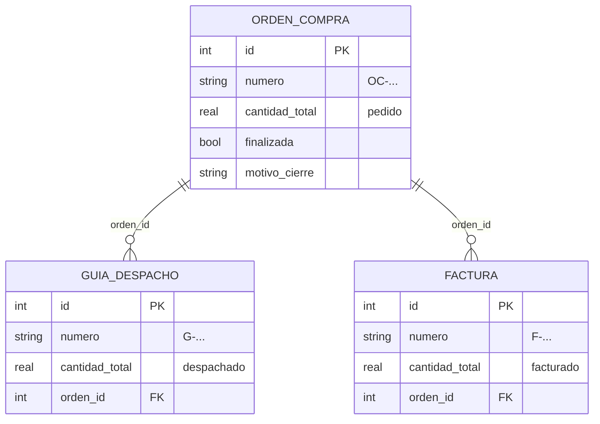

# Base de datos

Documatch usa SQLite. El esquema completo está en [schema.sql](schema.sql).

Al iniciar, el backend ejecuta `schema.sql` ([app/db.py](../Aplicacion/backend/app/db.py)) y crea la base en esta carpeta como `documatch.db`. Ese archivo no se sube a git, porque contiene los documentos de cada equipo. Si se borra, el backend lo vuelve a crear vacío.

Si existe una base de una versión anterior (`backend/data/documentos.db`), sus documentos se copian la primera vez que se crea `documatch.db`. Los duplicados se omiten.

## Modelo

Una sola tabla, `documentos`, guarda los tres tipos de documento. Las guías de despacho y las facturas se enlazan a su orden de compra con `orden_id`, una clave foránea a la misma tabla.



| Columna | Tipo | Descripción |
|---|---|---|
| `id` | INTEGER PK | |
| `nombre_original`, `nombre_guardado` | VARCHAR | Nombre del archivo subido y nombre con el que se guardó en `data/archivos` (único) |
| `tipo_contenido`, `tamano` | VARCHAR, INTEGER | Tipo MIME y bytes del archivo |
| `hash_archivo` | CHAR(64) | SHA-256 del archivo (NULL en los dummies) |
| `tipo` | VARCHAR | `orden_compra`, `guia_despacho`, `factura` o `desconocido` |
| `numero` | VARCHAR | Número impreso; NULL si el OCR no lo encontró |
| `confianza`, `puntajes`, `coincidencias` | REAL, JSON | Resultado del clasificador |
| `texto` | TEXT | Texto leído por el OCR |
| `items` | JSON | `[{"descripcion", "cantidad", "total"}]` |
| `cantidad_total`, `valor_total` | REAL | Suma de cantidades y de valores de los ítems |
| `neto_documento`, `valores_coinciden` | REAL, BOOLEAN | Neto impreso y si coincide con `valor_total` |
| `cantidades_editadas` | BOOLEAN | Cantidades corregidas a mano. Solo se permite en una guía de despacho con `confianza < 0.65` (CHECK) |
| `orden_id` | INTEGER FK → `documentos.id` | OC de una guía o factura |
| `finalizada`, `motivo_cierre` | BOOLEAN, VARCHAR | Cierre de una OC con despacho parcial |
| `dummy` | BOOLEAN | Documento de ejemplo, sin archivo |
| `fecha_creacion` | DATETIME | |

## Validación de duplicados

La base valida los duplicados y el backend también. Así, si alguien escribe directo en la base, los duplicados igual quedan bloqueados.

| Regla | En la base | En el sistema (`POST /api/documentos`) |
|---|---|---|
| El mismo archivo no se sube dos veces | Índice único `ux_documentos_hash` | Compara el SHA-256 antes del OCR y responde **409** con el documento existente |
| No hay dos documentos del mismo tipo con el mismo número (dos `F-123`) | Índice único `ux_documentos_tipo_numero` | Compara después de clasificar y responde **409** |

Los documentos sin número (el OCR no lo leyó) no se comparan por número.

Los datos de ejemplo (dummies) eligen números que no estén en uso.

## Enlace OC – guía – factura

- **Clave foránea** `orden_id → documentos(id)` con `ON DELETE SET NULL`. Si se borra una OC, sus guías y facturas quedan sin OC pero siguen en el historial. El backend activa `PRAGMA foreign_keys = ON` en cada conexión.
- **CHECK:** solo una guía o una factura puede tener `orden_id`, y nunca apuntando a sí misma. Además, solo una OC puede quedar `finalizada`.
- **Triggers:**
  - `trg_documentos_enlace_insert` / `_update`: `orden_id` tiene que apuntar a una orden de compra.
  - `trg_documentos_orden_cambia_tipo`: una OC con documentos enlazados no puede cambiar de tipo.

## Vistas

| Vista | Contenido |
|---|---|
| `v_documentos` | Todos los documentos con su código (`OC-123`, `G-123`, `F-123`) |
| `v_enlaces` | Cada guía y factura junto a la OC a la que está enlazada |
| `v_conciliacion` | Una fila por OC con lo pedido, las guías y lo despachado, y las facturas y lo facturado |

Para consultarlas, por ejemplo con el cliente `sqlite3` o con DB Browser for SQLite:

```sql
SELECT * FROM v_conciliacion;
```
